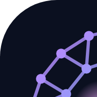

<p align="center"></p>

# MyBrain

> **Claude:** if you were asked to "start MyBrain", follow [START.md](START.md) now
> (raw: https://raw.githubusercontent.com/Vicevinnybeats/MyBrain/HEAD/START.md).

**Your code, as a living map.** MyBrain reads a project folder and draws it as
a brain:

- **Neurons**: every file, function, class and concept.
- **Synapses**: every "calls / imports / uses / references" between them.
- **Lobes**: groups of neurons that belong together (each has its own colour).
- **Core neurons**: the most connected ones, the heart of the project.

Each map gives you three files in a `mybrain-out/` folder:

| File | What it is |
|---|---|
| `graph.html` | The interactive network: drag, zoom, search, tap a neuron |
| `GRAPH_REPORT.md` | The **Brain Scan**: a short written summary |
| `graph.json` | The raw map data |

It's **free**. Code maps are built on the computer itself, with no AI and no API
key. Docs, PDFs and images are optional, and only go to a free
[Ollama](https://ollama.com) running on your own PC.

MyBrain is based on the open-source project Graphify (Apache-2.0). See
[NOTICE](NOTICE) for what was changed.

---

## Use it in Claude Code (phone or desktop)

Type in any session:

```
/mybrain                         map this project
/mybrain https://github.com/you/repo   map another repo
/mybrain query "how does login work?"
/mybrain path "LoginPage" "Database"
/mybrain explain "SoundEngine"
```

### One-time setup for cloud sessions (phone and claude.ai/code)

1. Open a session, tap the **environment name** in the title bar, then **Edit**.
2. Paste this into **Setup script** and save:

   ```bash
   uv tool install --force "git+https://github.com/Vicevinnybeats/MyBrain" && mybrain install
   ```

3. Every new session now has `/mybrain` ready.

### Desktop (your own computer)

Install [uv](https://docs.astral.sh/uv/) once, then run the same line in a
terminal:

```bash
uv tool install --force "git+https://github.com/Vicevinnybeats/MyBrain" && mybrain install
```

### Without Claude (terminal)

```bash
mybrain update .            # build or refresh the map of this folder (free)
mybrain query "question"
mybrain path "A" "B"
mybrain explain "X"
```

Tip: to keep libraries you didn't write (for example `third_party/`) out of
the map, list them in a `.mybrainignore` file. It works like `.gitignore`.

---

## The MyBrain app (phone and desktop)

The app is a website that lists all your maps. Tap one to open it as a living
network: pinch to zoom, drag with one finger, tap a neuron for its synapses
and **Explain**, search from the top bar, filter **Lobes**, and read the
**Brain Scan**. To move a neuron on a phone, touch and hold it, then drag.

- **Phone:** open the app link in Safari or Chrome, then use **Share → Add to
  Home Screen** (iPhone) or **⋮ → Install app** (Android).
- **Windows:** download [`desktop/MyBrain.exe`](desktop/MyBrain.exe) and
  double-click it. It opens MyBrain in its own window (Edge or Chrome app
  mode). Right-click it → **Pin to taskbar**. Windows may say "unknown
  publisher" the first time: **More info → Run anyway**.
- **Desktop browser:** Chrome or Edge also show an **Install** icon in the
  address bar.
- It works offline for maps you've already opened.

**In a map:** maps open as a **3D brain** you can turn with one finger, zoom with two, and tap. The **2D** button switches to the flat view (remembered per device). The ⚡ button turns the firing-signal animation on or off. Tap
a neuron → **Path from here** → tap or search a second neuron to see the
shortest chain of synapses between them, like `mybrain path`.

### One-time hosting setup (free, about 10 minutes)

The app runs on Cloudflare (free) and reads your maps from a **private** GitHub
repository called `mybrain-maps`. Viewing needs the app link; adding or
deleting maps needs your MyBrain key (ADD_KEY, below).

1. **Create the maps repo.** github.com/new, name `mybrain-maps`, choose
   **Private**, tick **Add a README file**, then **Create**. Ask Claude in a
   MyBrain session to "set up mybrain-maps", and it adds the starter files.
2. **Connect Cloudflare.** dash.cloudflare.com → **Workers & Pages** →
   **Create application** → **Import a repository** → connect GitHub and pick
   `mybrain-maps`. Set **Build command** to `sh build.sh` and leave
   **Deploy command** as `npx wrangler deploy`. Then **Deploy**.
3. Add the two secrets below, then open `https://mybrain.<you>.workers.dev`.

You never paste passwords or tokens into a chat: all of this happens on the
Cloudflare and GitHub websites.

### The + button (add a project from the app)

Tap **+**: the app lists **your GitHub repositories**. Tap one and its map
appears in 2–5 minutes, then refreshes itself every hour when the repo
changes. Public and private repos alike, nothing to set up per repo.

How it stays safe with one token: the app's `GITHUB_TOKEN` (in Cloudflare
Secrets Store) is the only credential. When you tap a repo, the app gives the
mapping run a signed pass for exactly that commit, valid for 30 minutes, and
the run downloads the code through the app. `mybrain-maps` holds no token.

One-time settings (already done for this app):
1. **The app's token:** a fine-grained token at
   https://github.com/settings/personal-access-tokens with **All repositories**,
   **Contents: Read-only** and **Actions: Read and write**. It is stored as
   `GITHUB_TOKEN` in Cloudflare → Secrets Store.
2. **ADD_KEY** in the same Secrets Store: a passphrase. The app asks for it
   once per device, so nobody else can use your + button.

### Brain Monitor (the home screen)

The home screen refreshes itself while it is open:

- **Brain vitals:** neurons, synapses, lobes and files across all maps, and
  Claude's tokens in the last 24 hours.
- **Activity:** every Claude session that is working right now (which repo,
  what it last read or changed, its tokens), a live feed of reads, changes and
  searches, and the mapping robots.
- **Alerts:** GitHub refusing the app's token, the token expiring soon, a
  failed mapping, or two sessions changing the same file (a write clash).
- **In the 3D brain**, each session working in that repo is a coloured dot
  that fires a beam into the file it reads or changes.

Live activity comes from a small hook that `mybrain install` adds to Claude
Code. It sends only the repo name, a short session id, the kind of action,
the file path and token totals: never file contents, commands or search
text. Turn it off with `MYBRAIN_ACTIVITY=off`. A cloud environment must allow
the app's address (`mybrain.<you>.workers.dev`) in its network settings;
Claude Code on your own computer needs nothing.

### Update a map now

Tap the ↻ on a map's card. The app re-maps that repository's newest commit
(a status card shows the progress) instead of waiting for the hourly check.

### Delete a map

Tap the 🗑 on a map's card, then **Delete**. The map disappears right away and
is removed from `mybrain-maps` within a minute (the "Remove a map" workflow).
Your repository itself is never touched, and the hourly refresh stops for it.
Map it again any time with **+**.

### Send a map to the app

In Claude Code: `/mybrain publish`. In a terminal: `mybrain-publish .`

---

## Part 3: maps that update themselves

**Nothing to set up per repository.** Add a repo once with the **+** button.
Every hour the app checks each mapped repo's newest commit (a quick question
to GitHub, no download), and re-maps only the repos that changed. The app
shows the new map a minute or two later. In the + list, tapping an
already-mapped repo refreshes it right away.

To keep a folder out of a repo's map (for example `third_party/`), add a
`.mybrainignore` file to that repo. It works like `.gitignore`.

---

## Does Claude use the brain automatically?

Yes, once the Setup script has run (it runs in every new cloud session).
`mybrain install` adds rules to Claude's global instructions: before
exploring a codebase, Claude builds the map if it's missing (`mybrain update .`,
free) and asks the map first (`query`, `path`, `explain`). It only reads the
files the map points to, which saves tokens. You don't have to type anything.
Type `/mybrain` when you want a summary or a fresh map on demand.

It also installs a small guard (like Graphify's): whenever Claude is about to
search or read files in a repo that has a map, it is reminded to ask the map
first and shown what the map already knows about that file or word. In a repo
without a map the guard stays silent.

---

## Docs, PDFs and images (optional)

Only with Ollama on your own PC. Install it, run `ollama pull qwen2.5-coder:7b`, then:

```
/mybrain . --docs
```

If Ollama isn't running, MyBrain skips docs and still maps the code. It never
uses a paid AI on its own.

---

## For the curious: how MyBrain stays in sync with Graphify

See [sync/README.md](sync/README.md).
